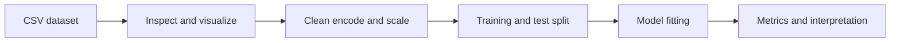

# AI, Machine Learning, and Data Science Notebooks

**A practical collection of exercises, exploratory analysis, and model-building notebooks.**

This repository records coursework and experiments in Python data science. The notebooks progress from array and table operations to preprocessing, visualization, and supervised-learning comparisons.

## Start here

| Notebook | Focus |
|---|---|
| [`Numpy.ipynb`](Numpy.ipynb) | Array operations |
| [`Pandas.ipynb`](Pandas.ipynb) | Tabular data operations |
| [`Assignment_1.ipynb`](Assignment_1.ipynb) | NumPy exercises |
| [`Data_Preprocessing-assignment3.ipynb`](Data_Preprocessing-assignment3.ipynb) | Missing values, encoding, scaling, and data splitting |
| [`Data_visualization_Assignment.ipynb`](Data_visualization_Assignment.ipynb) | Exploratory plots |
| [`Employee_attrition.ipynb`](Employee_attrition.ipynb) | Attrition analysis and classifier comparisons |
| [`Spotify_Songs_Genre_Segmentation.ipynb`](Spotify_Songs_Genre_Segmentation.ipynb) | Song-data exploration and segmentation experiments |

## Run the notebooks

Use Python and Jupyter in an isolated environment:

```bash
python -m venv .venv
source .venv/bin/activate
pip install jupyter numpy pandas matplotlib seaborn scipy scikit-learn joblib
jupyter notebook
```

Open a notebook from the repository root. Check its dataset-loading cells and adjust paths for your machine. Titanic, employee-attrition, and Spotify CSV files are included in the tree.

The repository does not pin a complete environment. Additional notebook imports may require dependencies beyond this starting set.

## Typical workflow



The employee-attrition notebook includes logistic regression, decision tree, and random forest experiments. Saved notebook output reflects those experiments and is not a fresh benchmark run.

## Purpose and scope

This collection is intended for learning and comparison. It is not a packaged ML service. Read the preparation and evaluation cells before interpreting any model result, and keep data preparation separated from held-out evaluation when extending the exercises.

Coursework attribution in the notebooks identifies **Kelavath Balaji Naik, 21BCE9738**.
